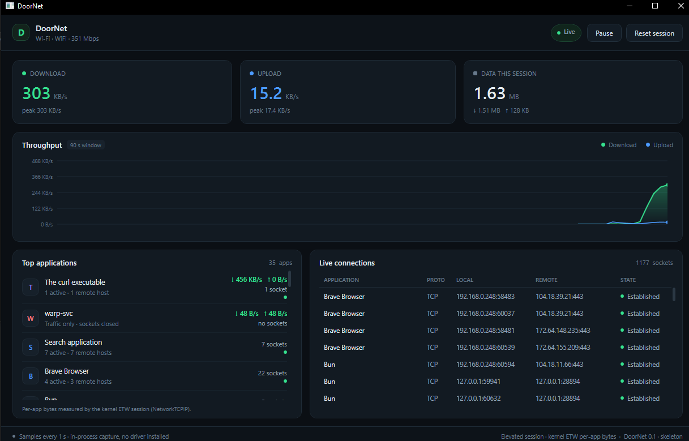

# DoorNet

A Windows network activity monitor: live throughput, per-application sockets, and the
machine's real connection list — with a dark instrument-panel UI.

**Status: milestone 3 in progress.** The app builds, runs unprivileged, and shows real OS
data. Per-application byte usage is measured by an in-process kernel ETW session when the
app is elevated (one click from the header); unelevated it says exactly why it can't.



---

## Run it

Requires the **.NET 10 SDK** (this machine has it; .NET 8 works too if you retarget).

```powershell
dotnet run --project src/DoorNet.App
```

Or:

```powershell
dotnet build DoorNet.slnx
.\src\DoorNet.App\bin\Debug\net10.0-windows\DoorNet.App.exe
```

No administrator rights, no driver, no installer yet.

## Test it

```powershell
dotnet test
```

50 unit tests cover the sampling maths, counter-reset handling, ring buffer, axis scaling,
byte formatting, per-app aggregation, traffic-only rows, and loopback filtering.

---

## What v1 actually does

| Panel | Source | Elevation |
|---|---|---|
| Download / upload rate | `NetworkInterface.GetIPStatistics()` on the default-route adapter | none |
| Session data total | Integral of the above, reset on demand | none |
| 90 s throughput chart | In-memory ring buffer, custom-drawn WPF control | none |
| Top applications | `GetExtendedTcpTable` / `GetExtendedUdpTable` grouped by owning PID | none |
| Per-app byte rates | Kernel ETW, `Microsoft-Windows-Kernel-Network` (`NetworkTCPIP`) | **admin** |
| Live connections | Same tables (IPv4 + IPv6, TCP + UDP) | none |

Three deliberate correctness decisions:

1. **One adapter, not forty.** Windows exposes counters per adapter and virtual adapters
   (Hyper-V `vEthernet`, WSL, VMware host-only) mirror traffic that also crosses the
   physical NIC. Summing everything double-counts, so DoorNet follows the single adapter
   that owns a default gateway and has moved the most bytes.
2. **No fake per-app numbers.** Windows has no unprivileged per-process byte counters.
   Unelevated, the app shows a reason instead of inventing a value; **Restart elevated**
   relaunches it for the kernel ETW session.
3. **Never hijack the kernel logger.** `NT Kernel Logger` is one system-wide session.
   If Process Monitor, GlassWire or WPR already owns it, DoorNet reports that rather than
   stopping their session (it creates with `NoRestartOnCreate`).
4. **Loopback is not network usage.** ETW reports `127.0.0.1` transfers as kernel network
   events, but they never touch a NIC and adapter counters exclude them. Both views exclude
   them, so a localhost-heavy app (Updaters, torrent clients, RPC) cannot inflate the
   per-app column above the real adapter throughput.

Verified end-to-end with a throttled 100 MB download: `curl.exe` appears in Top applications
with its live rate, and the per-app number tracks adapter throughput once the 1 s EMA settles.

## Architecture

```
src/
  DoorNet.Core/      models, interfaces, sampler, aggregation, formatting  (net10.0, no Windows APIs)
  DoorNet.Capture/   iphlpapi P/Invoke, adapter counters, process names    (net10.0-windows)
  DoorNet.App/       WPF shell, view-models, custom throughput chart       (net10.0-windows)
tests/
  DoorNet.Core.Tests/
```

The UI only talks to interfaces in `DoorNet.Core`, so the future ETW collector can be
swapped in behind `IPerAppUsageSource` without touching the views. Full design notes,
milestones, elevation model, packaging and risk list: **[docs/ARCHITECTURE.md](docs/ARCHITECTURE.md)**.

## Roadmap

| # | Milestone | State |
|---|---|---|
| 1 | Live throughput + connection inventory | **done** |
| 2 | SQLite history, 24 h charts | next |
| 3 | Elevated ETW per-app byte usage (`Microsoft-Windows-Kernel-Network`) | **in-process done**, service pending |
| 4 | Tray icon, start with Windows, new-connection alerts | planned |
| 5 | Signed installer + auto-update | planned |

## Notes

- `reverse.eng/` contains a GlassWire installer and a Ghidra export of its **NSIS installer
  stub**. It is reference material only: DoorNet shares no code, assets or branding with
  GlassWire, and its UI is an original design.
- This is a monitoring tool. It reads the connection table and adapter counters; it does
  not capture packet contents, modify traffic, or open firewall rules.
