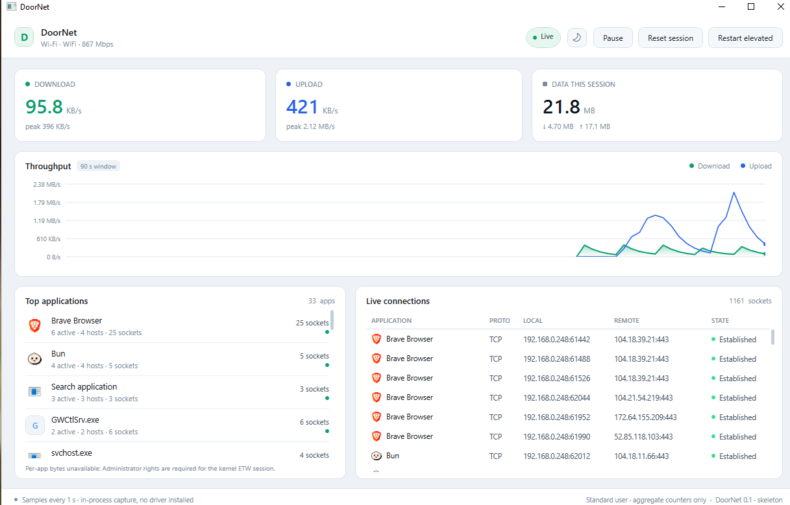

# DoorNet

A Windows network activity monitor: live throughput, per-application usage and totals,
the machine's real connection list, light/dark themes, and one-click internet blocking
per application.

**Status: milestone 3 + firewall.** The app builds, runs unprivileged, and shows real OS
data. On launch it asks for elevation once (UAC) because per-application byte usage and
firewall control need administrator rights; cancelling keeps the limited view with an
**Enable per-app meters** button in the applications card.


<details>
<summary>Light theme</summary>



</details>

---

## Run it

Requires the **.NET 10 SDK** (this machine has it; .NET 8 works too if you retarget).

```powershell
cd C:\Users\t4nv1r\Desktop\DoorNet
dotnet run --project src/DoorNet.App
```

Or use the launcher (builds first, then starts):

```powershell
.\run.cmd
```

The app relaunches itself through UAC on startup so per-app meters and firewall control work
immediately; dismissing the prompt keeps the unprivileged view. Disable that with
`"AutoElevate": false` in `%LocalAppData%\DoorNet\settings.json`.

Manual equivalent:

```powershell
dotnet build DoorNet.slnx
.\src\DoorNet.App\bin\Debug\net10.0-windows\DoorNet.App.exe
```

Close the app before rebuilding — it holds `bin\` DLLs while running.

## Test it

```powershell
dotnet test
```

69 unit tests cover the sampling maths, counter-reset handling, ring buffer, axis scaling,
byte formatting, per-app aggregation, traffic-only rows, loopback filtering, session
totals, and firewall rule naming.

---

## What v1 actually does

| Panel | Source | Elevation |
|---|---|---|
| Download / upload rate | `NetworkInterface.GetIPStatistics()` on the default-route adapter | none |
| Session data total | Integral of the above, reset on demand | none |
| 90 s throughput chart | In-memory ring buffer, custom-drawn WPF control | none |
| Top applications | `GetExtendedTcpTable` / `GetExtendedUdpTable` grouped by owning PID | none |
| Per-app byte rates | Kernel ETW, `Microsoft-Windows-Kernel-Network` (`NetworkTCPIP`) | **admin** |
| Per-app data totals | Accumulated per `(pid, image)` for the session, shown beside each rate | **admin** |
| Remote server map | `ip-api.com` geolocation of public remote IPs, cached 30 days | internet |
| Live connections | Same tables (IPv4 + IPv6, TCP + UDP) | none |

Three deliberate correctness decisions:

1. **One adapter, not forty.** Windows exposes counters per adapter and virtual adapters
   (Hyper-V `vEthernet`, WSL, VMware host-only) mirror traffic that also crosses the
   physical NIC. Summing everything double-counts, so DoorNet follows the single adapter
   that owns a default gateway and has moved the most bytes.
2. **No fake per-app numbers.** Windows has no unprivileged per-process byte counters.
   Unelevated, the app shows a reason instead of inventing a value; **Restart elevated**
   relaunches it for the kernel ETW session.
3. **Never hijack the kernel logger.** `NT Kernel Logger` is one system-wide session.
   If Process Monitor, GlassWire or WPR already owns it, DoorNet reports that rather than
   stopping their session (it creates with `NoRestartOnCreate`).
4. **Loopback is not network usage.** ETW reports `127.0.0.1` transfers as kernel network
   events, but they never touch a NIC and adapter counters exclude them. Both views exclude
   them, so a localhost-heavy app (Updaters, torrent clients, RPC) cannot inflate the
   per-app column above the real adapter throughput.

Verified end-to-end with a throttled 100 MB download: `curl.exe` appears in Top applications
with its live rate, and the per-app number tracks adapter throughput once the 1 s EMA settles.

## Blocking an application

Every application row has **two status pills** — `IN CONNECTIONS` and `OUT CONNECTIONS` —
showing **Allowed** (green with a check) or **Blocked** (red). **In is the download
direction, Out is the upload direction.** Click a pill to toggle that direction for that
executable. Rules are grouped `DoorNet` in Windows Defender Firewall and the per-direction
state persists in `%LocalAppData%\DoorNet\firewall.json`.

Windows Firewall is stateful, so blocking **Out** also stops new downloads (the request can
never leave), while blocking **In** stops unsolicited incoming traffic — downloads the app
initiated still return. Allow both directions to restore an app completely.

The header carries the **master switch** — `Firewall ON` / `Firewall OFF`:

- **ON** arms every DoorNet rule; individual blocks take effect immediately.
- **OFF** leaves the rules defined but *disabled* (`Enabled: No`), so all apps can connect
  again without losing your block list. Per-app changes are refused while it is off.

The master switch does **not** block anything by itself — it only arms the per-app rules.
An upload you still see while `Firewall ON` usually means traffic from a *different*
process (browser helper exes, `svchost`-hosted services) or an already-established flow.

Why rules instead of a driver: GlassWire ships its own WFP driver (`gwdrv.sys`) to enforce
its firewall. DoorNet deliberately does not — an OS rule needs no kernel component, survives
reboots, is visible in Windows Firewall, and can be removed even if DoorNet is uninstalled.
The trade-offs are honest:

- **Requires elevation** — creating rules needs administrator rights. Right-clicking while
  unelevated offers to restart elevated.
- **Per executable** — blocking `app.exe` does not block another binary; apps with a
  separate network helper exe need that one blocked too.
- **Only efficient while Windows Firewall is enforcing.** If another tool disables Windows
  Firewall, the rule is inert. (GlassWire's own firewall mode does that.)
- **Protected processes** (`lsass`, PPL/EDR) have no readable path, so DoorNet disables the
  menu action instead of guessing.

Verified on this machine: blocking `curl.exe` made connections fail (`curl` exit 7) with
the rule present; allowing it removed the rule and restored connectivity.

## Architecture

```
src/
  DoorNet.Core/      models, interfaces, sampler, aggregation, formatting  (net10.0, no Windows APIs)
  DoorNet.Capture/   iphlpapi P/Invoke, adapter counters, process names    (net10.0-windows)
  DoorNet.App/       WPF shell, view-models, custom throughput chart       (net10.0-windows)
tests/
  DoorNet.Core.Tests/
```

The UI only talks to interfaces in `DoorNet.Core`, so the future ETW collector can be
swapped in behind `IPerAppUsageSource` without touching the views. Full design notes,
milestones, elevation model, packaging and risk list: **[docs/ARCHITECTURE.md](docs/ARCHITECTURE.md)**.

## Roadmap

| # | Milestone | State |
|---|---|---|
| 1 | Live throughput + connection inventory | **done** |
| 2 | SQLite history, 24 h charts | next |
| 3 | Elevated ETW per-app byte usage (`Microsoft-Windows-Kernel-Network`) | **in-process done**, service pending |
| 3b | Per-app internet blocking (Windows Firewall rules) | **done**, requires elevation |
| 4 | Tray icon, start with Windows, new-connection alerts | planned |
| 5 | Signed installer + auto-update | planned |

## Notes

- **Map:** the equirectangular world outline is Natural Earth 110m land data (public domain),
  bundled as `Assets/world-land.geojson` and drawn as vector geometry. Remote endpoints are
  geolocated with `ip-api.com` (free, no key), one lookup every 1.4 s, cached for 30 days in
  `%LocalAppData%\DoorNet\geo-cache.json`. Private, loopback, link-local and reserved
  addresses are filtered client-side and never leave the machine; only public remote IPs are
  sent to the service.
- **Themes:** the header sun/moon button switches light/dark instantly and the choice is
  saved to `%LocalAppData%\DoorNet\settings.json`. All UI colours are semantic brushes in
  `Styles/Palette.*.xaml`; the window repaints in place without a restart.
- **Windows 10 title bar:** `DWMWA_CAPTION_COLOR` is Windows 11-only, and Windows 10 ignores
  the immersive flag when the system is in dark mode, so the *native* title bar keeps
  following the system theme. The app content itself themes fully.
- `reverse.eng/` contains a GlassWire installer and a Ghidra export of its **NSIS installer
  stub**. It is reference material only: DoorNet shares no code, assets or branding with
  GlassWire, and its UI is an original design.
- This is a monitoring and blocking tool. It reads the connection table and adapter
  counters and adds/removes firewall rules; it does not inspect packet contents.
